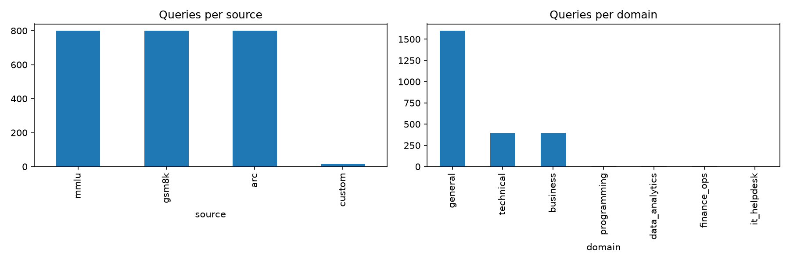

# LLM Router: Cost-Aware Model Routing

A router that decides, for each question, whether a cheap LLM is good enough or a stronger, more expensive one is needed. It is trained on real benchmark outcomes, served through a FastAPI endpoint, and evaluated with a cost versus quality curve.

## Status
Work in progress. Week 1: project setup, data collection, and EDA.

## Planned stack
Python, pandas, SQLite, scikit-learn, sentence-transformers, FastAPI, LangGraph, Streamlit.

## How to run
Instructions will be added as the project develops.

## Data
## Data
The `queries` table (2,415 questions, stored in SQLite) combines:
- **MMLU** (800): technical subjects (machine learning, computer science, statistics, security) and business subjects (management, marketing, accounting, economics)
- **GSM8K** (800): grade-school math word problems
- **ARC-Challenge** (800): science questions
- **Custom set** (15, growing to about 150): hand-written questions on Python, Java, C, IT helpdesk, data analytics, and finance operations

Each row has a known correct answer, so model replies can be graded automatically. Licenses and terms of use: confirm each dataset's license on its Hugging Face page and note it here.

## Results
Cost versus quality results will be added after evaluation.